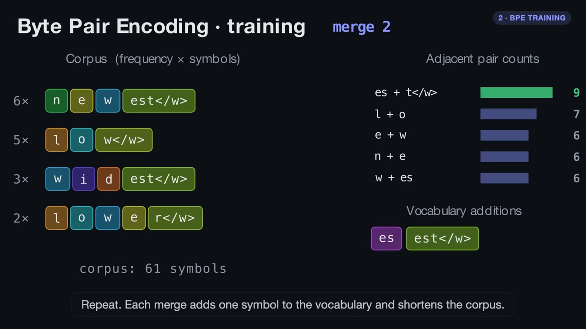
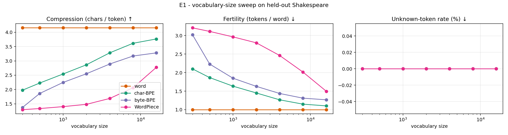

# The Tokenizer

**Word-level and sub-word tokenizers (BPE, byte-level BPE, WordPiece) implemented from scratch, with an interactive web visualizer that simulates the training and encoding process step by step.**

*An academic-style project by Pranav Singh: implementation → verification → experiments → report.*

[](https://github.com/Pranav-Singh-Devloper/The_Tokenizer/actions)

### ▶ Live demo: **https://the-tokenizer.vercel.app**

[](https://huggingface.co/datasets/pranav-singh-developer-1/the-tokenizer-video/resolve/main/the-tokenizer.mp4)

**[▶ Watch the 2-minute explainer](https://huggingface.co/datasets/pranav-singh-developer-1/the-tokenizer-video/resolve/main/the-tokenizer.mp4)** · [video on Hugging Face Datasets](https://huggingface.co/datasets/pranav-singh-developer-1/the-tokenizer-video) · [research report](docs/report.md)
*(animated with Manim, composed with Remotion; source in [`video/`](video/))*

| | |
|---|---|
| 🧪 **Library** | `src/tokenlab`: pure Python, **zero dependencies** |
| ✅ **Verified** | 48 Python tests · 9 JS parity tests · **token-for-token identical to OpenAI's GPT-2 tokenizer** (338,025 tokens of Shakespeare) |
| 🔬 **Research** | 5 experiments on held-out text: [`docs/report.md`](docs/report.md) |
| 🎬 **Visualizer** | `web/`: no build step; runs the real algorithms in your browser |
| 🎞️ **Video** | `video/`: Manim + Remotion explainer, hosted on [Hugging Face](https://huggingface.co/datasets/pranav-singh-developer-1/the-tokenizer-video) |

## Why this exists

An LLM reads integers, not text. The tokenizer that produces them decides sequence length, vocabulary
size, how rare words are handled and what the model can represent at all. This repo builds each
major family from first principles so the trade-offs can be *measured and watched*, not just read about.

## The web visualizer

```bash
python -m http.server -d web 8000     # then open http://localhost:8000
```

| Tab | What you do |
|---|---|
| **Training lab** | Step through every merge in three phases: *count* pairs → *choose* the winner → *merge*. Switch between character BPE, byte-level BPE and WordPiece (shows the actual score arithmetic). |
| **Encoding lab** | Pick a chunk of unseen text and watch the learned merges replay in rank order (BPE) or the longest-match window shrink (WordPiece). |
| **Playground** | Train word / BPE / byte-BPE / WordPiece on a corpus, type anything, compare segmentations, unknowns and losslessness. |
| **Experiments** | Interactive vocabulary-sweep chart and the result tables from the report. |

The browser code (`web/js/core.js`) is a port of the Python library, **tested against golden fixtures
exported from Python** (`cd web && npm test`), so what you see is the real algorithm.

## The library

```python
from tokenlab import BPETokenizer, WordPieceTokenizer, WordTokenizer

text = open("data/raw/shakespeare.txt").read()

bpe = BPETokenizer.train(text, vocab_size=2000, byte_level=True)   # GPT-2 style
ids = bpe.encode("Shakespeare's unbelievably tokenization-proof 🐱")
assert bpe.decode(ids) == "Shakespeare's unbelievably tokenization-proof 🐱"   # always lossless

wp = WordPieceTokenizer.train(text, vocab_size=2000, score="gain")
print(wp.tokenize("counterrevolutionary"))   # ['counter', '##re', '##vol', '##ution', '##ary']

bpe.save("bpe.json")
```

Watch training happen: `BPETokenizer.train(..., on_merge=lambda step: print(step))`.

### Design in one picture

```
text ─► pre-tokenize ─► model ─► ids
        (regex split)   ├─ Word       : vocabulary lookup, <unk> fallback
                        ├─ BPE        : replay learned merges in rank order
                        └─ WordPiece  : greedy longest-match with ## pieces

training:  MergeEngine (incremental pair counts)  +  scoring rule
                         BPE: most frequent pair     WordPiece: count(ab)/(count(a)·count(b))
```

## Headline results

On 1 MB of Tiny Shakespeare, evaluated on 112 KB held out (full tables in the [report](docs/report.md)):

* **The open-vocabulary problem is real.** Even a word vocabulary containing *every* training word leaves **4.0%** of held-out tokens unknown (11.4% at V=2000).
* **Byte-level BPE is the only lossless option** and never emits `<unk>`; it costs ≈11% compression versus character BPE at V=2000.
* **WordPiece's textbook score underperforms** on a real corpus (1.48 chars/token vs 2.86 for BPE at V=2000); a frequency-weighted gain score reverses that (3.17). *(Our ablation, discussed with caveats in the report.)*
* **Vocabularies encode their training data:** a 2k Shakespeare vocabulary gets 1.46 bytes/token on Python code versus 2.21 for GPT-2's 50k.



## Reproduce everything

```bash
pip install -e '.[dev,experiments,validate]'
python scripts/fetch_data.py             # Tiny Shakespeare + GPT-2 reference files -> data/raw/
pytest                                    # unit, property and GPT-2 parity tests
python scripts/validate_gpt2.py          # side-by-side parity report vs tiktoken
python experiments/run_experiments.py    # regenerates results/ and web/data/experiments.json
python scripts/export_fixtures.py && (cd web && npm test)   # JS <-> Python parity
```

## Repository map

```
src/tokenlab/     the library (pretokenize, merge_engine, bpe, wordpiece, word, metrics, gpt2)
tests/            pytest suite (incl. GPT-2 parity)
experiments/      run_experiments.py: all numbers and figures in the report
results/          CSV / JSON / PNG outputs (committed for reproducibility)
scripts/          fetch_data, validate_gpt2, export_fixtures
web/              static visualizer (ES modules, no build) + Node parity tests
video/            Manim scenes + Remotion composition for the explainer video (build.sh)
docs/report.md    the write-up: background, method, verification, results, threats to validity
```

## Learning path

1. Read the *Background* section of the [report](docs/report.md) (10 minutes).
2. Open the **Training lab** with the Sennrich toy corpus and predict each winner before pressing *Next phase*.
3. Switch to WordPiece on the same corpus and find a merge where it disagrees with BPE.
4. Open the **Encoding lab** and explain why `lowest` becomes `low` + `est</w>` though `lowest` never appeared in training.
5. In the **Playground**, find an input where only byte-level BPE is lossless.
6. Read `merge_engine.py` and write down why `merge()` only touches words in the inverted index.

## License

MIT, © Pranav Singh. Tiny Shakespeare is public domain; GPT-2 reference files are © OpenAI (MIT) and are downloaded on demand, not redistributed here.
