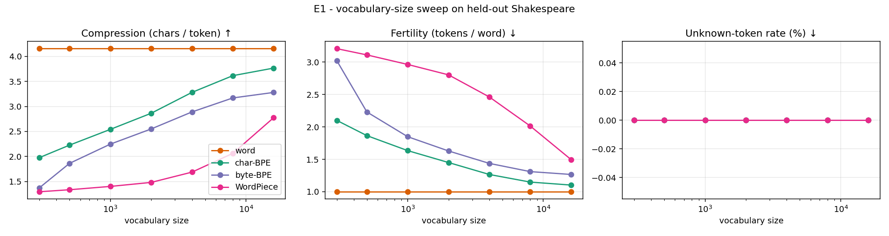
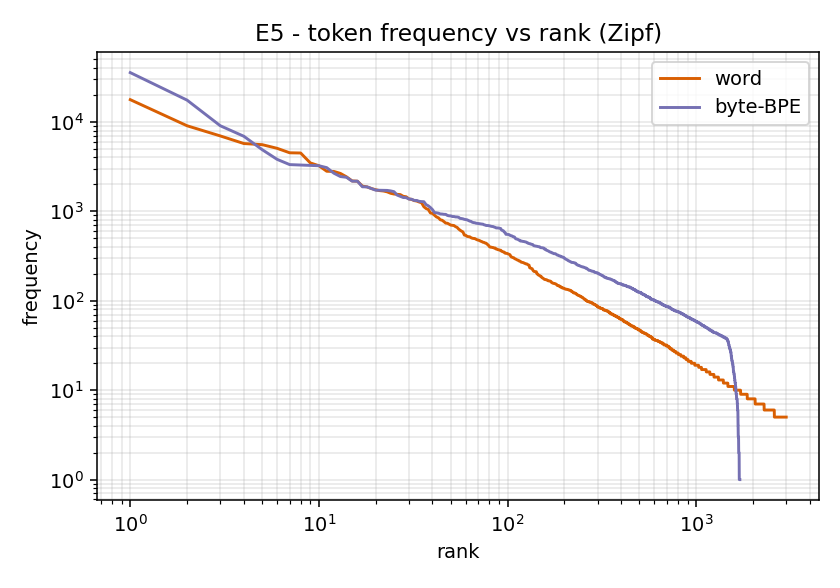

# Tokenizers from Scratch: Word-Level, BPE, Byte-Level BPE and WordPiece

**Pranav Singh** · Project report · 2026 · [▶ 2-minute explainer video](https://huggingface.co/datasets/pranav-singh-developer/the-tokenizer-video/resolve/main/the-tokenizer.mp4) · [live demo](https://the-tokenizer.vercel.app)

> **Abstract.** A language model never sees text, only integers, and the function that maps one to
> the other, the *tokenizer*, silently fixes sequence length, vocabulary size, robustness to rare
> words and what the model can even represent. We implement four tokenizers from scratch with only the Python
> standard library (word-level, character-level BPE, byte-level BPE and WordPiece), verify them
> three ways (unit/property tests, an incremental-vs-recount invariant, and *token-for-token
> parity with OpenAI's GPT-2 tokenizer*), and compare them on held-out text across vocabulary
> sizes and domains. We also ship a browser visualizer whose JavaScript port of the algorithms is
> tested against golden fixtures produced by the Python code. Main findings: (i) a word-level
> vocabulary still leaves 4.0% of held-out tokens unknown even when it contains *every* training word;
> (ii) sub-word models remove unknowns entirely at the price of 1.1–3.2× more tokens per word (at V=2000: 1.3–2.8);
> (iii) the textbook WordPiece score `count(ab)/(count(a)·count(b))` compresses far worse than
> BPE on a realistic corpus, and a frequency-weighted likelihood-gain variant reverses that;
> (iv) a tokenizer trained on one domain degrades sharply on another (a 2k Shakespeare vocabulary
> reaches 1.46 bytes/token on Python code versus 2.21 for GPT-2's 50k vocabulary).

---

## 1. Motivation and learning objectives

Neural language models operate on fixed-size embedding tables, so text must be mapped to a *finite*
set of symbols. Three obvious choices fail in different ways:

| Granularity | Failure mode |
|---|---|
| Characters / bytes | Sequences are 4–5× longer; attention cost is quadratic in length. |
| Words | Open-vocabulary problem: unseen words become `<unk>`; vocabulary must be huge. |
| Fixed morphemes | Needs per-language linguistics. |

Sub-word tokenization learns a vocabulary *from data* that sits between characters and words. This
project's learning objectives are to:

1. state the open-vocabulary problem precisely and measure it (E1);
2. implement BPE training and encoding and explain why encoding *replays* merges in order;
3. implement WordPiece and explain how its scoring rule and its greedy longest-match encoder
   differ from BPE;
4. explain why byte-level BPE is lossless and never emits `<unk>` (verified by test, E2);
5. quantify the compression ↔ vocabulary-size ↔ domain-shift trade-offs (E1, E4);
6. validate an implementation against a trusted reference, not just against its own tests.

## 2. Background

**Pre-tokenization.** Text is first cut into *pre-tokens*; learned merges never cross a pre-token
boundary. We provide a whitespace-dropping word splitter (classic BPE, WordPiece) and the GPT-2
regular expression, which keeps whitespace attached to the following word so that
`"".join(pretokens) == text`.

**BPE** (Gage 1994; Sennrich et al. 2016). Start from characters; repeatedly merge the most frequent
adjacent pair; record the ordered merge list. *Encoding* an unseen word starts from characters and
applies, at each step, the earliest-learned merge that is applicable.

**Byte-level BPE** (Radford et al. 2019). Run BPE over UTF-8 bytes, so the base alphabet is exactly 256
symbols and no string is out-of-vocabulary. Bytes are mapped to visible Unicode characters for
storage (space ↦ `Ġ`).

**WordPiece** (Schuster & Nakajima 2012; Wu et al. 2016; Devlin et al. 2018). Same merge loop, but a
pair is chosen to maximise `count(ab) / (count(a)·count(b))`, motivated by the likelihood gain under
a unigram model. Encoding does not replay merges; it uses the final vocabulary with a greedy
longest-match-first scan and `##` continuation pieces, falling back to `[UNK]` for the whole word if
the scan fails.

*Not implemented:* the Unigram LM tokenizer (Kudo 2018, SentencePiece) is listed under future work.

## 3. Implementation

```
src/tokenlab/
  pretokenize.py   word / BERT-basic / GPT-2 splitters
  bytes_unicode.py byte <-> printable-unicode bijection
  merge_engine.py  incremental pair statistics (shared by BPE and WordPiece)
  bpe.py           trainer + encoder (character and byte level), merge tracing
  wordpiece.py     trainer (ratio and gain scores) + greedy longest-match encoder
  word.py          frequency-ranked word vocabulary with <unk>
  metrics.py       compression, fertility, unk-rate, round-trip
  gpt2.py          loads OpenAI's GPT-2 merges into OUR encoder (validation only)
```

**One merge loop, two scoring rules.** BPE and WordPiece differ *only* in step 1 of the loop
(choose a pair). `MergeEngine` keeps `pair_counts`, an inverted index `pair → words`, and
`symbol_counts`; a merge touches only the words that contain the pair, rather than re-scanning the
corpus (O(touched words) per merge instead of O(corpus)). Training 16k merges on 1 MB takes 4.6–6.2 s for BPE and ratio-WordPiece (12.5 s for the gain variant, which does extra floating-point work per pair per step).

**Determinism.** Ties are broken by the lexicographically smallest pair (by code point); WordPiece
compares fractions by integer cross-multiplication so results are exact and identical across
languages. Training is therefore bit-for-bit reproducible.

**Nested vocabularies.** The first *k* merges of a size-*V* BPE are exactly the size-(base+*k*) model.
`truncated(V)` exploits this, so a whole vocabulary sweep needs a single training run (tested:
`test_truncated_equals_shorter_training_run`).

## 4. Verification

| Check | What it establishes |
|---|---|
| 48 Python tests | Pre-tokenizers lossless on random Unicode; byte-level round trip on arbitrary strings; special tokens atomic; determinism; serialisation; trace consistency. |
| **Incremental == recount** | After every merge, on 15 random corpora, `MergeEngine`'s counts and inverted index equal a from-scratch recount. |
| Sennrich toy example | First merges `(e,s)` then `(es,t</w>)` with count 9, as in the original paper. |
| **GPT-2 parity** | Loading GPT-2's 50,000 merges into *our* encoder gives ids identical to `tiktoken` on 19 edge cases (emoji, CJK, `\r\n`, 200× `a`, contractions…) and on all of Tiny Shakespeare (**338,025 tokens**). Run `python scripts/validate_gpt2.py`. |
| JS ↔ Python parity | 9 Node tests: for 7 configurations the JS port reproduces the Python merge list, vocabulary ids, tokenization and per-word encoding traces exactly. |

Two real bugs were caught by these mechanisms and are recorded in the history: the word tokenizer's
`tokenize()` initially did not emit `<unk>` for out-of-vocabulary words (its unk rate read 0%), and
the first inverted-index implementation could leave stale word ids behind.

## 5. Experimental setup

* **Corpus:** Tiny Shakespeare (public domain), 1,115,394 characters. Train = first 90% on a line
  boundary (1,003,836 chars, 10,828 distinct lower-cased words); test = remaining 111,558 chars.
  **3.98%** of test word tokens never occur in training.
* **Metrics** (on the held-out test text): `chars/token` (compression), `tokens/word` (fertility;
  Rust et al. 2021), unknown-token rate, exact round trip.
* **Models:** word-level; character BPE (`</w>` marker, lossy decode); byte-level BPE (GPT-2 regex,
  lossless); WordPiece with the textbook ratio score; WordPiece with a frequency-weighted
  *gain* score `c·ln(c·N/(c_a·c_b))` (our ablation).
* Everything is deterministic: `python experiments/run_experiments.py` regenerates `results/`.

## 6. Results

### E1 - Vocabulary-size sweep (held-out Shakespeare)



| Tokenizer | V=300 | V=1000 | V=2000 | V=8000 |
|---|---|---|---|---|
| **chars/token** ↑ | | | | |
| char-BPE | 1.98 | 2.54 | 2.86 | 3.62 |
| byte-BPE | 1.37 | 2.25 | 2.55 | 3.17 |
| WordPiece (ratio) | 1.30 | 1.40 | 1.48 | 2.06 |
| WordPiece (gain) | 2.16 | 2.74 | 3.17 | 3.76 |
| **tokens/word** ↓ | | | | |
| char-BPE | 2.10 | 1.63 | 1.45 | 1.15 |
| byte-BPE | 3.02 | 1.85 | 1.63 | 1.31 |
| WordPiece (ratio) | 3.21 | 2.96 | 2.80 | 2.01 |
| WordPiece (gain) | 1.92 | 1.52 | 1.31 | 1.11 |
| **word-level unk rate** | 27.4% | 16.0% | 11.4% | 5.0% |

With *all* 10,832 training words in the vocabulary the word-level unk rate is still **4.0%**,
matching the corpus-level OOV rate: this is the open-vocabulary problem, and a bigger table cannot
fix it. Sub-word models have 0% unknowns at every size on this corpus (character-level BPE can in
principle emit `<unk>` for unseen characters; byte-level cannot).

### E2 - Head-to-head at V = 2000

| Tokenizer | train (s) | chars/token | tokens/word | unk | exact round trip |
|---|---|---|---|---|---|
| word | 0.08 | 4.16 | 1.00 | 11.4% | ✗ |
| char-BPE | 0.69 | 2.86 | 1.45 | 0% | ✗ |
| byte-BPE | 0.71 | 2.55 | 1.63 | 0% | **✓** |
| WordPiece (ratio) | 0.43 | 1.48 | 2.80 | 0% | ✗ |
| WordPiece (gain) | 2.07 | 3.17 | 1.31 | 0% | ✗ |

Only byte-level BPE is lossless: the others discard case, whitespace or accents at pre-tokenization.
**Caveat:** chars/token is not like-for-like across rows. The lossy pipelines discard whitespace
instead of spending tokens on it, and the word-level row looks best only because it hides
information behind `<unk>`.

### E3 - Unseen words (V = 2000)

| Word | byte-BPE | WordPiece (ratio) | WordPiece (gain) |
|---|---|---|---|
| unbelievability | `Ġun b el ie v ab il ity` | `unb ##e ##l ##i ##e ##v ##a ##b ##i ##l ##i ##t ##y` | `un ##b ##el ##ie ##v ##ab ##il ##ity` |
| counterrevolutionary | `Ġcoun ter re v ol ution ary` | 18 single characters | `counter ##re ##vol ##ution ##ary` |
| tokenization | `Ġto ken iz ation` | `to ##k ##e ##n ##iz ##a ##t ##i ##o ##n` | `to ##ke ##n ##iz ##ation` |

The word-level tokenizer maps every one of these to a single `<unk>`.

### E4 - Domain shift (bytes/token, higher is better)

| Tokenizer | Shakespeare (test) | Modern prose | Python code |
|---|---|---|---|
| byte-BPE, V=2000, Shakespeare-trained | 2.55 | 2.47 | **1.46** |
| WordPiece (gain), V=2000 | 3.17 | 2.69 (0.9% unk) | 2.08 (27.2% unk) |
| word, V=2000 | 4.16 (11.3% unk) | 5.43 (41.1% unk) | 3.01 (63.4% unk) |
| GPT-2 byte-BPE, V=50,257 (web text) | 3.09 | **5.07** | **2.21** |

A vocabulary encodes its training distribution. The Shakespeare-trained byte-BPE loses little on
modern prose (2.47 vs 2.55) but 43% on code (1.46), while GPT-2's web-text vocabulary compresses
prose twice as well as it compresses Shakespeare (5.07 vs 3.09). The lossy models show the same
shift as unknown tokens (up to 63% for the word model on code).

### E5 - Zipf



Both distributions are roughly Zipfian. The difference is in the tail: the word vocabulary has
10,828 distinct types, with a long tail of items seen ≤ 5 times (only the top 3,000 ranks are
plotted), whereas virtually every one of the ~1,700 byte-BPE tokens that occur at all is seen at
least ~30 times. Fewer rarely-seen tokens means fewer poorly-trained embeddings.

## 7. Discussion

**WordPiece's ratio score.** On a realistic corpus the bare ratio chose merges that left
compression at 1.30–1.48 chars/token for V ≤ 2000. Our reading, consistent with the data but not
proven by a controlled study here: a pair of symbols that are individually rare but co-occur scores
near the maximum regardless of how *often* that happens, so early merges build pieces of rare words
(a pure ratio has no frequency term). Multiplying by the pair count (our `gain` score) fixes the
behaviour and gives the best compression of all models at every vocabulary size tested. The
lesson for practitioners: the published description of the score is a simplification; production
implementations differ in details we do not have access to.

**Lossless vs. compact.** Byte-level BPE compresses ~11% worse than character BPE at V=2000 in
Fig. E1 but is the only model that round-trips every input. For an LLM, where the tokenizer must
accept arbitrary user text (code, emoji, other scripts), that guarantee is usually worth more than
the compression.

**Vocabulary size.** Every doubling of V buys a diminishing reduction in fertility but adds
`V × d_model` embedding (and output-projection) parameters; byte-BPE reaches 3.3 chars/token by
V=16k on this 1 MB corpus, beyond which a bigger corpus, not a bigger V, is the limiting factor.

## 8. Threats to validity and known deviations

* **Single, small, archaic corpus.** Conclusions about *relative* behaviour are likely to transfer;
  absolute numbers (e.g. 3.0 chars/token) will not.
* **Metric comparability** (see E2 caveat). A fairer cross-pipeline metric would count whitespace
  consistently or compare downstream perplexity, which we do not do.
* **Regex approximation.** Python's `re` lacks `\p{L}`; we use `[^\W\d_]` and equivalents. They agree
  with GPT-2's pattern on all tested text, but exotic characters (e.g. superscript digits, category
  `No`) can be classified differently from the reference.
* **JS port** does not special-case special tokens inside input text; the Python library does.
* **Single run per configuration.** Training is deterministic, so there is no seed variance, but
  there is also no confidence interval over alternative corpora or splits.

## 9. Future work

Unigram LM tokenizer with EM and pruning (Kudo 2018); BPE-dropout / subword regularisation;
SentencePiece-style whitespace handling; multilingual fertility analysis; downstream evaluation
(perplexity of a small language model per tokenizer at equal parameter count).

## 10. Reproducing

```bash
pip install -e '.[dev,experiments,validate]'
python scripts/fetch_data.py            # Tiny Shakespeare + GPT-2 reference files
pytest                                   # 48 tests, incl. GPT-2 parity
python scripts/validate_gpt2.py          # parity report vs tiktoken
python experiments/run_experiments.py    # regenerates results/ and web/data/experiments.json
python scripts/export_fixtures.py && (cd web && npm test)   # JS <-> Python parity
python -m http.server -d web 8000        # visualizer at http://localhost:8000
```

## References

* Gage, P. (1994). A new algorithm for data compression. *The C Users Journal*, 12(2).
* Schuster, M., Nakajima, K. (2012). Japanese and Korean voice search. *ICASSP*.
* Sennrich, R., Haddow, B., Birch, A. (2016). Neural machine translation of rare words with subword units. *ACL*.
* Wu, Y. et al. (2016). Google's neural machine translation system. arXiv:1609.08144.
* Radford, A. et al. (2019). Language models are unsupervised multitask learners (GPT-2). OpenAI.
* Devlin, J. et al. (2018). BERT: pre-training of deep bidirectional transformers. arXiv:1810.04805.
* Kudo, T. (2018). Subword regularization: improving NMT models with multiple subword candidates. *ACL*.
* Kudo, T., Richardson, J. (2018). SentencePiece. *EMNLP (System Demonstrations)*.
* Rust, P. et al. (2021). How good is your tokenizer? On the monolingual performance of multilingual language models. *ACL*.
